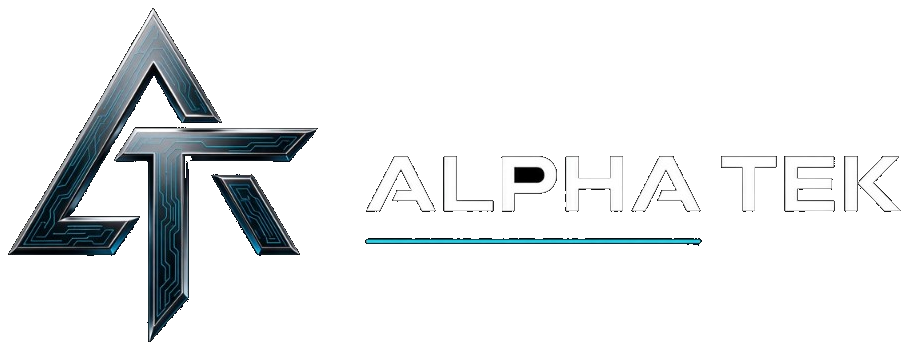
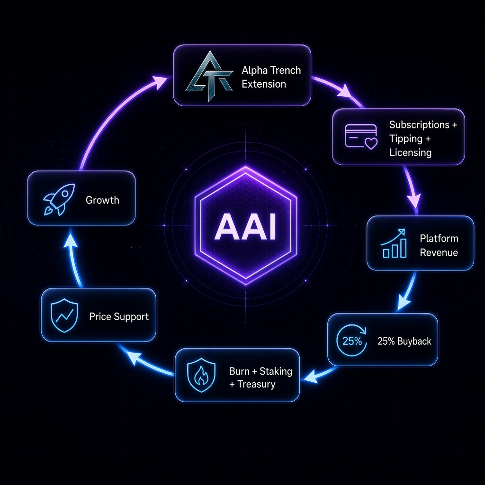
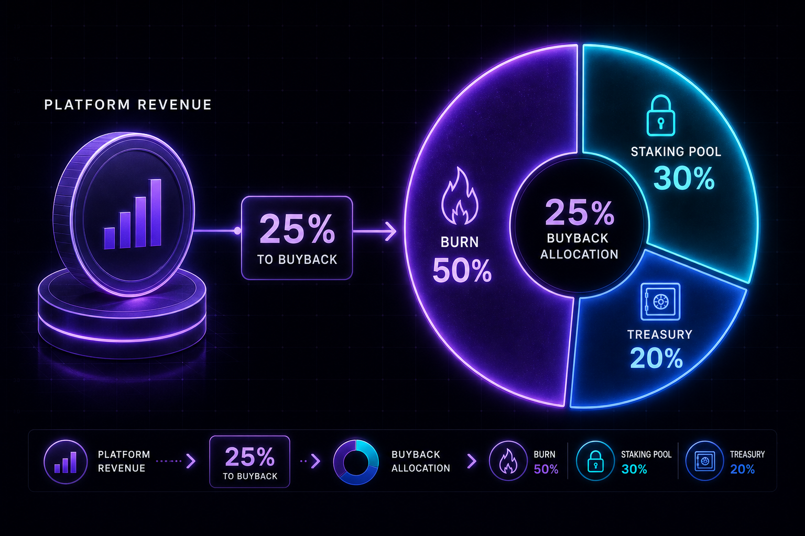
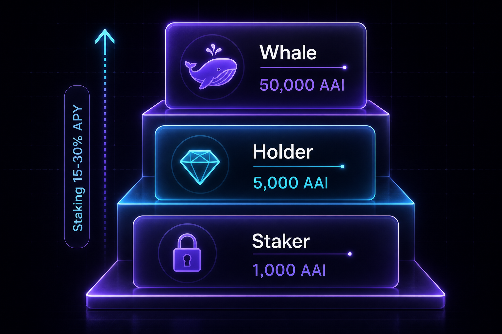
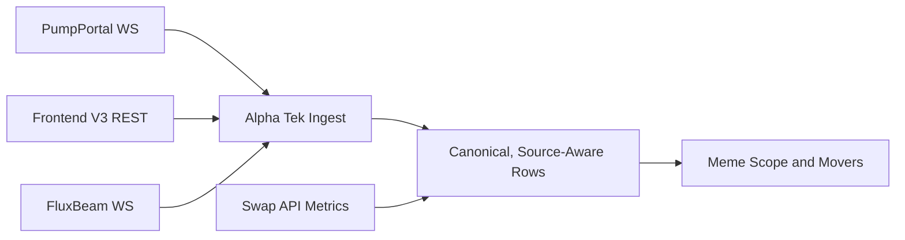
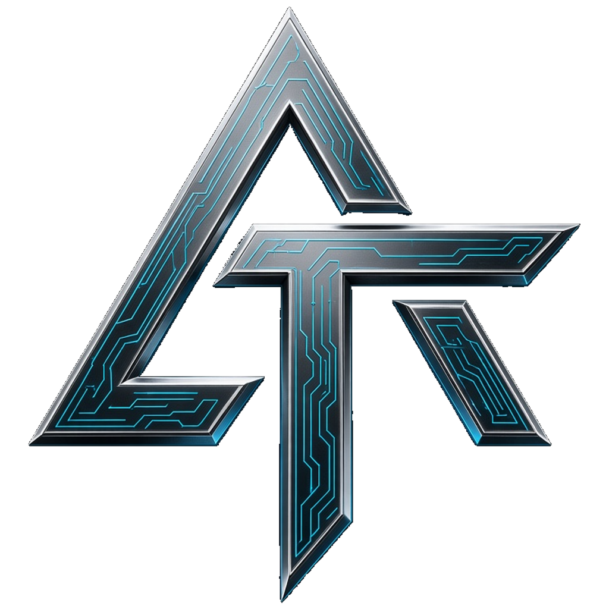

<!--
  PUBLIC product footprint. Alpha Tek web portal.
  No private source. The product is public. The warehouse stays private.
-->

<p align="center">
  <a href="https://www.alphatek.app">
    
  </a>
</p>

<div align="center">

  <h1>Alpha Tek Portal</h1>

  <p>
    <strong>Crypto intelligence at one view.</strong><br />
    <sub>AlphaTek.App · Alpha Trench 0.9.542 · Platform 1.3 · AAI 2.1</sub>
  </p>

  <p>
    For more than three years, Epic Alpha offered free tools, alpha, and intel.<br />
    That chapter is morphing into an ecosystem: <strong>subscriptions and Discord licensing</strong>, <strong>AAI utility</strong>, and the <strong>Alpha Trench extension</strong>.<br />
    The live product is [AlphaTek.App](https://www.alphatek.app). The warehouse stays private.
  </p>

  <p>
    <a href="https://www.alphatek.app">
      
    </a>
    &nbsp;
    <a href="https://alphatek.app/whitepaper">
      
    </a>
    &nbsp;
    <a href="https://alphatek.app/alpha-trench">
      
    </a>
    &nbsp;
    <a href="https://discord.gg/sPW3tJk">
      
    </a>
  </p>

  <p>
    
    
    
    
  </p>

  <p>
    
  </p>

</div>

---

<div align="center">

## What This Repo Is

A public product footprint for the Alpha Tek web portal, the live site at [AlphaTek.App](https://www.alphatek.app).

<table>
  <thead>
    <tr>
      <th align="center">Included</th>
      <th align="center">Not included</th>
    </tr>
  </thead>
  <tbody>
    <tr>
      <td align="center">Product map, surface guide, partners, flywheel</td>
      <td align="center">Application source code</td>
    </tr>
    <tr>
      <td align="center">Links to the live product and Build Journey</td>
      <td align="center">Infrastructure secrets and ops</td>
    </tr>
    <tr>
      <td align="center">The public and private boundary</td>
      <td align="center">Private monorepo access</td>
    </tr>
  </tbody>
</table>

Core platform code stays private until a deliberate open release. The product is public. The warehouse is not.

---

## Why The Portal Exists

Most crypto terminals split the work across eight charts, a chat dump, and a safety tool on someone else's brand.

Alpha Tek puts that work in one browser product: see what is moving, open a token, check social and KOL heat, practice in Alpha Trench, and route value through subscriptions, licensing, and AAI.

---

## The Flywheel

Traders enter through **Alpha Trench**. Subscriptions, tipping, and Discord licensing fund the platform. **25% of platform revenue** is designed for buybacks. That buyback splits **50% burn**, **30% staking pool**, and **20% treasury**.

<p>
  
</p>

AAI access tiers, from the current paper:

<p>
  
</p>

On-chain programs are proven on Solana devnet. Mainnet stays gated on an external audit. The product does not wait on that gate.

---

## Live Pump.fun Intelligence

What the Pump ecosystem exposes live is reconciled into Alpha Tek through three independent lanes:



- **56 upstream routes audited** through the production proxy
- **35 live JSON routes** and **4 auth-gated routes** cataloged
- **16 retired routes** blocked before runtime network egress
- Pump.fun and BONK/Raydium rows stay labeled and independently selectable
- Last-good snapshots and per-source circuits keep one upstream failure from blanking the desk

<p>
  
</p>

---

## Product Surfaces

<table>
  <thead>
    <tr>
      <th align="center">Surface</th>
      <th align="center">Job</th>
    </tr>
  </thead>
  <tbody>
    <tr>
      <td align="center"><strong>Explorer</strong></td>
      <td align="center">Multi-chain market and token context</td>
    </tr>
    <tr>
      <td align="center"><strong>Discover</strong></td>
      <td align="center">Narrative, pool, and heat discovery</td>
    </tr>
    <tr>
      <td align="center"><strong>Pump.fun / launch rails</strong></td>
      <td align="center">New, bonding, and graduated context</td>
    </tr>
    <tr>
      <td align="center"><strong>Wallet / portfolio</strong></td>
      <td align="center">Multi-chain wallet views where connected</td>
    </tr>
    <tr>
      <td align="center"><strong>Quant</strong></td>
      <td align="center">Calls, flex, profiles, performance context</td>
    </tr>
    <tr>
      <td align="center"><strong>TG Arena</strong></td>
      <td align="center">Telegram-call structured alpha</td>
    </tr>
    <tr>
      <td align="center"><strong>KOL Scope</strong></td>
      <td align="center">Influencer and social heat</td>
    </tr>
    <tr>
      <td align="center"><strong>Alpha Guard</strong></td>
      <td align="center">Host, domain, mint, and approval awareness</td>
    </tr>
    <tr>
      <td align="center"><strong>Alpha Terminal</strong></td>
      <td align="center">Hybrid coin pages for majors and the catalog</td>
    </tr>
    <tr>
      <td align="center"><strong>Trench Replay Theater</strong></td>
      <td align="center"><a href="https://www.alphatek.app/dashboard/alpha-replay">Cast, Forecast, wallet and chart playback</a></td>
    </tr>
    <tr>
      <td align="center"><strong>Market Replay</strong></td>
      <td align="center">Any token page, fullscreen chart playback</td>
    </tr>
    <tr>
      <td align="center"><strong>Alpha Academy</strong></td>
      <td align="center">Courses, quizzes, certificates</td>
    </tr>
    <tr>
      <td align="center"><strong>AAI Hub</strong></td>
      <td align="center">Stake, claim, and utility. Devnet proof. Mainnet gated.</td>
    </tr>
    <tr>
      <td align="center"><strong>News Hub</strong></td>
      <td align="center">One merged headline desk</td>
    </tr>
    <tr>
      <td align="center"><strong>Market Intel</strong></td>
      <td align="center">Global metrics, ETF flow, derivatives, cycle indicators</td>
    </tr>
    <tr>
      <td align="center"><strong>Watchlist</strong></td>
      <td align="center">Saved coins with price, market cap, volume, and 24h direction</td>
    </tr>
    <tr>
      <td align="center"><strong>Alpha Spy</strong></td>
      <td align="center">Entity and connection context for mints and wallets</td>
    </tr>
    <tr>
      <td align="center"><strong>Alpha Trench</strong></td>
      <td align="center">Instant Trade, paper books, Guard, Mint Intel. Version 0.9.542. Linked sessions feed the leaderboard and weekly contests.</td>
    </tr>
    <tr>
      <td align="center"><strong>API Library</strong></td>
      <td align="center"><strong>1,500+</strong> platform endpoints behind one session. Keys stay server-side.</td>
    </tr>
    <tr>
      <td align="center"><strong>Alpha Tek MCP</strong></td>
      <td align="center">Reserved. Same library, shaped for agents. Ships after QA.</td>
    </tr>
    <tr>
      <td align="center"><strong>Alpha Brain</strong></td>
      <td align="center">Append-only memory for calls, search heat, and replay, queryable by mint</td>
    </tr>
    <tr>
      <td align="center"><strong>Subscribe / Help</strong></td>
      <td align="center">Stripe payments and support</td>
    </tr>
    <tr>
      <td align="center"><strong>Build Journey</strong></td>
      <td align="center"><a href="https://www.alphatek.app/changelog">Public ship log</a></td>
    </tr>
  </tbody>
</table>

**Open it:** [https://www.alphatek.app](https://www.alphatek.app)

---

## How It Fits The Stack

```text
Alpha Tek Portal · alphatek.app
   |  Epic Alpha Discord · community and commands
   |  Alpha Trench 0.9.542 · paper, journal, leaderboard, contests
   +-> AAI utility · stake, referral, flywheel
```

One ecosystem. One brand.

- Portal and Discord share community proof and the command stack
- Portal and Alpha Trench share pair-page execution, Guard, journal, and replay
- Linked extension sessions feed the trench leaderboard and weekly trade contests
- Trench Replay Theater holds Cast, Forecast, Market Replay, and Wallet Replay
- Alpha Brain keeps calls, heat, and replay queryable by mint
- The API library is 1,500+ endpoints. Alpha Tek MCP is the agent door, reserved until QA
- AAI Hub holds utility, staking, and the referral ladder

<table>
  <thead>
    <tr>
      <th align="center">Product doc</th>
      <th align="center">Repo</th>
    </tr>
  </thead>
  <tbody>
    <tr>
      <td align="center"><strong>Whitepapers</strong></td>
      <td align="center"><a href="https://github.com/JohnnyxSmokes/alpha-tek-whitepaper">Platform 1.3 · AAI 2.1</a></td>
    </tr>
    <tr>
      <td align="center"><strong>Epic Alpha Discord</strong></td>
      <td align="center"><a href="https://github.com/JohnnyxSmokes/epic-alpha-discord">epic-alpha-discord</a></td>
    </tr>
    <tr>
      <td align="center"><strong>Alpha Trench Windows</strong></td>
      <td align="center"><a href="https://github.com/JohnnyxSmokes/alpha-trench-windows">0.9.542</a></td>
    </tr>
    <tr>
      <td align="center"><strong>Alpha Trench Safari</strong></td>
      <td align="center"><a href="https://github.com/JohnnyxSmokes/alpha-trench-safari">0.9.542</a></td>
    </tr>
    <tr>
      <td align="center"><strong>Founder profile</strong></td>
      <td align="center"><a href="https://github.com/JohnnyxSmokes">JohnnyxSmokes</a></td>
    </tr>
  </tbody>
</table>

---

## Intelligence Partners

Alpha branding is public. Vendor plumbing stays server-side. The rails behind the experience include, as a non-exhaustive map:

<table>
  <thead>
    <tr>
      <th align="center">Domain</th>
      <th align="center">Rails</th>
    </tr>
  </thead>
  <tbody>
    <tr>
      <td align="center"><strong>On-chain and wallets</strong></td>
      <td align="center">Moralis · Cielo · Helius-class Solana rails · Jupiter</td>
    </tr>
    <tr>
      <td align="center"><strong>Launch discovery</strong></td>
      <td align="center">Pump.fun ecosystem · Raydium-class pools</td>
    </tr>
    <tr>
      <td align="center"><strong>Social / KOL</strong></td>
      <td align="center">KOL boards · curated X and Telegram call pathways</td>
    </tr>
    <tr>
      <td align="center"><strong>Markets</strong></td>
      <td align="center">CoinGecko · macro boards · Hyperliquid perps context · prediction markets</td>
    </tr>
    <tr>
      <td align="center"><strong>Auth and payments</strong></td>
      <td align="center">Privy wallet login · Stripe subscriptions · JWT sessions</td>
    </tr>
    <tr>
      <td align="center"><strong>Infra</strong></td>
      <td align="center">Production cloud hosting · PostgreSQL · institutional themes</td>
    </tr>
  </tbody>
</table>

Exact routing is private. The user-facing story is many feeds, one Alpha layer.

---

## Security Posture

- **Server-side keys only.** The browser never holds provider API secrets.
- **Privy** for wallet login, **Stripe** for payments, **JWT** for the Alpha Tek session.
- **Freshness-aware UI.** Live dashboards show honest data age.
- **Alpha Guard** on the portal, the extension, and Discord.
- **Alpha Trench 0.9.542** ships with a SHA-256 and a public VirusTotal report. Windows scanned 0 malicious, 0 suspicious, 66 undetected. Safari scanned 0 malicious, 0 suspicious, 65 undetected. That is evidence for those hashes. Reports: [Windows](https://www.virustotal.com/gui/file/90542940d9e457a9c817359cfc6948c1201ffaf53f22fb3aa1ba717d3da8833f) · [Safari](https://www.virustotal.com/gui/file/80b7bc6478f2eba64d9d327f69a5f93688890dcecc23bea618ddb7952b07da2d).

The platform monorepo stays private. Entity tracking and Alpha Spy run through the same server-side layer as the rest of the intel desks.

---

## Three Rails

For more than three years, free tools, alpha, and intel were the whole model. That chapter is morphing. Portal sustainability now runs on three rails:

1. **Subscriptions and Discord licensing.** Paid depth on alphatek.app, and bot and channel packs for other communities.
2. **AAI utility.** Access tiers, staking, and credits. **25% of platform revenue** is designed for buybacks: 50% burn, 30% staking pool, 20% treasury.
3. **Alpha Trench.** The extension is the entry. Version 0.9.542. Paper first. Mainnet Instant Trade stays locked until armed.

Full synopsis: [alpha-tek-whitepaper](https://github.com/JohnnyxSmokes/alpha-tek-whitepaper).
**AAI Hub:** [aai-hub](https://github.com/JohnnyxSmokes/aai-hub) · [Open hub](https://www.alphatek.app/dashboard/aai)
**Discord licensing:** [discord-licensing](https://github.com/JohnnyxSmokes/discord-licensing)

---

## Build In Public

<table>
  <thead>
    <tr>
      <th align="center">Proof</th>
      <th align="center">Where</th>
    </tr>
  </thead>
  <tbody>
    <tr>
      <td align="center"><strong>Live product</strong></td>
      <td align="center"><a href="https://www.alphatek.app">alphatek.app</a></td>
    </tr>
    <tr>
      <td align="center"><strong>Ship log</strong></td>
      <td align="center"><a href="https://www.alphatek.app/changelog">alphatek.app/changelog</a></td>
    </tr>
    <tr>
      <td align="center"><strong>Dev heat</strong></td>
      <td align="center"><a href="https://github.com/JohnnyxSmokes">github.com/JohnnyxSmokes</a></td>
    </tr>
    <tr>
      <td align="center"><strong>Community</strong></td>
      <td align="center"><a href="https://discord.gg/sPW3tJk">discord.gg/sPW3tJk</a></td>
    </tr>
  </tbody>
</table>

Thousands of commits on the current platform era, on a 14+ year crypto track from BTC 2012. The public changelog is the ship log. Private repositories hold the implementation. The contribution graph stays verifiable.

---

## Who It Is For

- People who got wrecked, refuse to get wrecked again, or only have a little capital
- Operators living in Telegram, Discord, and pair pages
- Investors weighing the replication cost of a real multi-surface stack
- Partners who need one brand for intel

---

## Links

<table>
  <thead>
    <tr>
      <th align="center"></th>
      <th align="center"></th>
    </tr>
  </thead>
  <tbody>
    <tr>
      <td align="center"><strong>Portal</strong></td>
      <td align="center"><a href="https://www.alphatek.app">https://www.alphatek.app</a></td>
    </tr>
    <tr>
      <td align="center"><strong>Changelog</strong></td>
      <td align="center"><a href="https://www.alphatek.app/changelog">https://www.alphatek.app/changelog</a></td>
    </tr>
    <tr>
      <td align="center"><strong>Whitepaper</strong></td>
      <td align="center"><a href="https://alphatek.app/whitepaper">https://alphatek.app/whitepaper</a></td>
    </tr>
    <tr>
      <td align="center"><strong>AAI Hub</strong></td>
      <td align="center"><a href="https://www.alphatek.app/dashboard/aai">https://www.alphatek.app/dashboard/aai</a></td>
    </tr>
    <tr>
      <td align="center"><strong>Academy</strong></td>
      <td align="center"><a href="https://www.alphatek.app/dashboard/alpha-academy">https://www.alphatek.app/dashboard/alpha-academy</a></td>
    </tr>
    <tr>
      <td align="center"><strong>Alpha Trench</strong></td>
      <td align="center"><a href="https://alphatek.app/alpha-trench">https://alphatek.app/alpha-trench</a></td>
    </tr>
    <tr>
      <td align="center"><strong>Discord</strong></td>
      <td align="center"><a href="https://discord.gg/sPW3tJk">https://discord.gg/sPW3tJk</a></td>
    </tr>
    <tr>
      <td align="center"><strong>X</strong></td>
      <td align="center"><a href="https://x.com/BitcoinHomework">https://x.com/BitcoinHomework</a></td>
    </tr>
  </tbody>
</table>

<p>
  
</p>

<sub>
  Alpha Tek Portal · Public product footprint · Code private by design<br />
  Built with passion since BTC 2012 · Epic Alpha · Alpha Tek
</sub>

</div>
