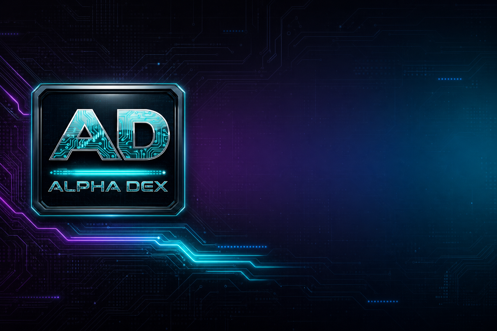
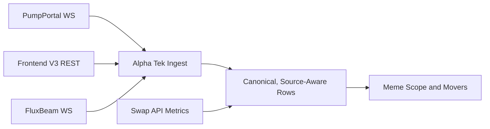

<!--
  PUBLIC product footprint — Alpha Tek web portal.
  No private source. Sell the product, point to alphatek.app.
-->

<p align="center">
  <a href="https://www.alphatek.app">
    
  </a>
</p>

<div align="center">

  <h1>Alpha Tek Portal</h1>

  <p>
    <strong>Crypto intelligence at one view.</strong><br />
    <sub>AlphaTek.App · Alpha Trench 0.9.542 · Platform 1.3 · AAI 2.1</sub>
  </p>

  <p>
    Live production portal for traders, researchers, and operators who want real multi-surface alpha —
    without cloning a monorepo or trusting vaporware decks.
  </p>

  <p>
    <a href="https://www.alphatek.app">
      
    </a>
    &nbsp;
    <a href="https://www.alphatek.app/changelog">
      
    </a>
    &nbsp;
    <a href="https://discord.gg/sPW3tJk">
      
    </a>
  </p>

  <p>
    
    
    
  </p>

</div>

---

## What This Repo Is

A **public product footprint** for the **Alpha Tek web portal** — the live site at [AlphaTek.App](https://www.alphatek.app).

| Included | Not included |
|----------|----------------|
| Product map, surface guide, partners, flywheel | Application source code |
| Links to live product + Build Journey | Infrastructure secrets / ops |
| Honest public-vs-private boundary | Private monorepo access |

Core platform code stays private until deliberate open releases. The **product** is public; the **warehouse** is not.

---

## Why The Portal Exists

Most “crypto terminal” products fragment users into:

- eight charts with no shared memory  
- Discord dumps that never become a workflow  
- Telegram heat with no journal  
- safety tools that live on someone else’s brand  

**Alpha Tek** puts intelligence in **one browser product**: Discover what is moving, open a token context, check social / TG / KOL heat, practice or execute from the trench client, and route value through subscriptions and **AAI** so free tools can survive.

---

## Live Pump.fun Intelligence

What the Pump ecosystem exposes live is reconciled into Alpha Tek through three independent lanes:



- **56 upstream routes audited** through production proxy.
- **35 live JSON routes** and **4 auth-gated routes** cataloged.
- **16 retired routes** blocked before runtime network egress.
- Pump.fun and BONK/Raydium rows stay labeled and independently selectable.
- Last-good snapshots and per-source circuits prevent one upstream failure from blanking the desk.


---

## Product Surfaces (Live)

| Surface | Job |
|---------|-----|
| **Explorer** | Multi-chain market / token context — depth without noise |
| **Discover** | Narrative, pool, and heat discovery across feeds |
| **Pump.fun / launch rails** | New / bonding / graduated context where Solana trench lives |
| **Wallet / portfolio** | Multi-chain wallet views and enrichment where connected |
| **Quant** | Social trading layer — calls, flex, profiles, performance context |
| **TG Arena** | Telegram-call structured alpha for operators |
| **KOL Scope** | Influencer / social heat without fake certainty |
| **Alpha Guard** | Host, domain, mint, and approval-awareness under Alpha brand |
| **Alpha Terminal** | Hybrid coin pages (majors + catalog) for research-grade context |
| **Trench Replay Theater** | Wallet + token replay, **Trench Cast**, Forecast, drawings — [open theater](https://www.alphatek.app/dashboard/alpha-replay) |
| **Market Replay** | Any token page → fullscreen chart playback, presentation mode |
| **Alpha Academy** | Interactive education paths (courses, quizzes, certificates) |
| **AAI Hub** | Stake / claim / utility rails (devnet program proof; mainnet gated) |
| **News Hub** | One merged headline desk: exchange news, CryptoRank, CoinGecko Buzz, Bitcoin.com |
| **Market Intel** | Global metrics, market pulse, ETF net flow, derivatives, cycle indicators, click-through price chart |
| **Watchlist** | Saved coins with price, market cap, volume, and 24h direction |
| **Alpha Spy** | Entity and connection context for mints and wallets |
| **Alpha Trench extension** | Instant Trade, paper books, Guard, Mint Intel. Linked sessions post to the live trench leaderboard and weekly trade contests |
| **API Library** | **1,500+** platform endpoints behind one Alpha Tek session. Public catalog on the site, keys stay server-side |
| **Alpha Tek MCP** | Coming soon. Same library, shaped for agents |
| **Alpha Brain / MLM** | Append-only memory for calls, search heat, and replay. Query by mint, fast enough to rank Trench Cast and paper context |
| **Subscribe / Help** | Stripe payments and support |
| **Build Journey / Changelog** | Public ship log and contribution narrative |

**Open it:** [https://www.alphatek.app](https://www.alphatek.app)

---

## How It Fits The Stack

```text
                    ┌─────────────────────────┐
                    │   Alpha Tek Portal      │
                    │   alphatek.app          │
                    │   Market + Trench Replay│
                    └───────────┬─────────────┘
           ┌────────────────────┼────────────────────┐
           │                    │                    │
           ▼                    ▼                    ▼
   Epic Alpha Discord    Alpha Trench (ext)     AAI Utility
   commands · feeds      paper · journal ·      stake · referral
   free depth first      Trade Replay           flywheel
                         live leaderboard
                         weekly contests
                         Trench Cast (web)
```

Everything is designed as **one ecosystem**, not three disconnected brands sharing a logo.

- Portal ↔ Discord for command-and-control + community proof
- Portal ↔ Alpha Trench for pair-page execution, Guard, journal, and platform history replay
- Portal ↔ the trench leaderboard and weekly trade contests when the extension session is linked
- Portal ↔ **Trench Replay Theater** for Cast, Forecast, Market Replay, Wallet Replay
- Portal ↔ Alpha Brain / MLM so calls, heat, and replay stay queryable by mint
- Portal ↔ the API library (1,500+ endpoints). Alpha Tek MCP is the agent door, marked Coming Soon
- Portal ↔ AAI Hub for utility, staking, and the referral ladder  

See also:

| Product doc | Repo |
|-------------|------|
| **Ecosystem whitepaper synopsis** | [alpha-tek-whitepaper](https://github.com/JohnnyxSmokes/alpha-tek-whitepaper) |
| **Epic Alpha Discord** | [epic-alpha-discord](https://github.com/JohnnyxSmokes/epic-alpha-discord) |
| **Alpha Trench** | [alpha-trench](https://github.com/JohnnyxSmokes/alpha-trench) |
| **Founder profile** | [JohnnyxSmokes](https://github.com/JohnnyxSmokes) |

---

## Intelligence Partners (Integration Footprint)

Alpha branding is **public**. Vendor plumbing stays server-side. Partnerships and data rails powering the experience include (non-exhaustive, product language):

| Domain | Partners / rails (illustrative) |
|--------|----------------------------------|
| **On-chain & wallets** | Moralis · Cielo · Helius-class Solana rails · Jupiter |
| **DEX / launch discovery** | Pump.fun ecosystem · Raydium-class pools · Dex research anchors |
| **Social / KOL** | KOL Scan-class boards · curated X/Telegram call pathways |
| **Markets** | CoinGecko · CMC-class macro · Hyperliquid perps context · prediction markets |
| **Auth & payments** | Privy wallet login · Stripe subscriptions · JWT sessions |
| **Infra** | Production cloud hosting · PostgreSQL · institutional UX themes |

Exact routing is private IP. User-facing story: **many feeds, one Alpha layer.**

---

## Security Posture (What Users Should Expect)

- **Server-side keys only.** The browser never holds provider API secrets.
- **Privy** for wallet login, **Stripe** for payments, **JWT** for the Alpha Tek session.
- **Freshness-aware UI.** Live dashboards show honest data age.
- **Alpha Guard** on the portal, the extension, and Discord.
- **Alpha Trench packages** ship with a SHA-256 and a VirusTotal report for that exact zip. The published 0.9.542 Windows and Safari builds scanned **0 malicious** and **0 suspicious**. That is evidence for those hashes, not a promise that every future build is clean. Reports live in the [Alpha Trench security note](https://github.com/JohnnyxSmokes/alpha-trench/blob/main/docs/SECURITY.md).

The platform monorepo stays private. Entity tracking and Alpha Spy run through the same server-side layer as the rest of the intel desks.

---

## Economics (Why It’s Sustainable)

Free intelligence for years is not a business model by itself. Portal sustainability routes through:

1. **Subscriptions** — unlock paid depth on alphatek.app  
2. **Discord product / licensing** — enterprise bot and channel packing  
3. **AAI utility** — access tiers, staking, credits — with **25% of platform revenue** designed for buybacks (deflationary flywheel design)  

Honest boundary: on-chain programs are **publicly proven on Solana devnet**; mainnet requires external audit gates. Product and Discord do not wait on token theater.

Full synopsis: [alpha-tek-whitepaper](https://github.com/JohnnyxSmokes/alpha-tek-whitepaper).  
**AAI Hub micro-footprint:** [aai-hub](https://github.com/JohnnyxSmokes/aai-hub) · [Open hub](https://www.alphatek.app/dashboard/aai)  
**Discord licensing micro-footprint:** [discord-licensing](https://github.com/JohnnyxSmokes/discord-licensing)

---

## Build In Public (Without Open Source Dumping)

| Proof surface | Where |
|---------------|--------|
| **Live product** | [alphatek.app](https://www.alphatek.app) |
| **Ship log** | [alphatek.app/changelog](https://www.alphatek.app/changelog) — Build Journey |
| **Dev heat** | [github.com/JohnnyxSmokes](https://github.com/JohnnyxSmokes) contribution graph |
| **Community** | [discord.gg/sPW3tJk](https://discord.gg/sPW3tJk) |

Thousands of commits on the current platform era, grounded in a **14+ year** crypto track (BTC 2012 to present). The public changelog is the ship log. Private repositories hide competitive implementation while the contribution graph stays verifiable.

---

## Who It’s For

- Newcomers who got wrecked and want **structured free tools first**  
- Operators living in TG / Discord / pair pages all day  
- Investors evaluating **replication cost** of a real multi-surface stack  
- Partners who need **one brand** for intel, not fifteen vendor badges  

---

## Links

| | |
|--|--|
| **Portal** | https://www.alphatek.app |
| **Changelog** | https://www.alphatek.app/changelog |
| **AAI Hub** | https://www.alphatek.app/dashboard/aai |
| **Academy** | https://www.alphatek.app/dashboard/alpha-academy |
| **Discord** | https://discord.gg/sPW3tJk |
| **X** | https://x.com/BitcoinHomework |

---

<div align="center">

  <sub>
    Alpha Tek Portal · Public product footprint · Code private by design<br />
    Built with passion since BTC 2012 · Epic Alpha · Alpha Tek
  </sub>

</div>
